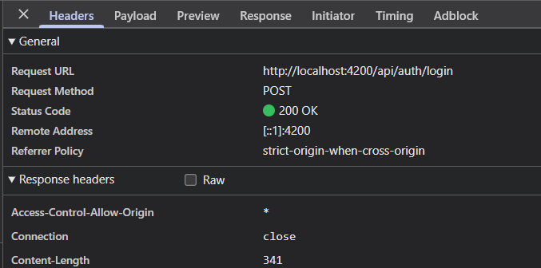
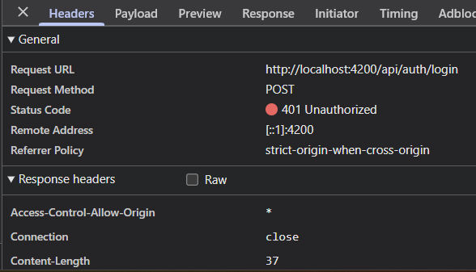

# Rapport d'usage de l'IA - TP1

Pour chaque mission, détailler et fournir des explications concernant : objectif; prompt principal; plan proposé par l'agent; vérifications réalisées par le binôme; erreurs ou propositions rejetées; fichiers effectivement modifiés; preuve de fonctionnement; ce que chaque membre sait maintenant expliquer sans l'agent.

## Outil et modèle

Nous avons utilisé Claude Code dans VS Code, avec le modèle Claude Opus 5.5.

On voit le modèle actif avec la commande `/model`. On voit la consommation de la session avec `/cost`. Les tokens comptent le prompt, les fichiers lus, l'historique et la réponse. Une longue conversation consomme donc plus, même avec des questions courtes.

Pour choisir un modèle, on peut demander conseil à l'assistant lui-même (voir `CONSEILS_POUR_UTIISER_ASSISTANT_AI.md`, partie 10). La documentation du fournisseur et l'enseignant peuvent aussi conseiller. Un modèle rapide suffit pour expliquer une notion. Un modèle plus puissant est utile pour analyser plusieurs fichiers ou chercher un bug difficile.

## Mission 0 - Cartographier l'application

**Objectif** : sans modifier le code, retrouver le composant racine, les routes, l'enregistrement de `HttpClient`, les modèles, services et pages, et le mécanisme qui ajoute le JWT. Faire un schéma du flux « Se connecter ». Séparer les routes publiques et protégées.

**Prompt principal** : « Faisons la mission 0 du TP 1 Sujet etudiant. »

**Démarche de l'agent** :

1. Lecture du sujet, du guide d'usage de l'IA, de `frontend-starter/CLAUDE.md` et de `API_CONTRACT.md`.
2. Lecture des fichiers de `frontend-starter/src` et de `proxy.conf.json`.
3. Lecture du backend : `src/app.js`, `src/server.js`, `src/models/User.js`.
4. Rédaction de la cartographie, du schéma et du tableau des routes.

Aucun build ni test n'a été lancé, car c'est une mission d'analyse. Le fichier `.env` n'a pas été lu.

**Fichiers modifiés** : aucun fichier de code. Nous avons créé `MISSION_0_CARTOGRAPHIE.md` et ce rapport.

**Production** : voir [MISSION_0_CARTOGRAPHIE.md](MISSION_0_CARTOGRAPHIE.md).

**Vérifications réalisées par le binôme** :

- Nous avons ouvert les fichiers cités pour vérifier les rôles décrits.
- Nous nous sommes connectés avec le compte démo.
- Dans Network, `POST /api/auth/login` part sans header `Authorization`. C'est normal, la route est publique.
- Les logs `[http]` et `[auth]` s'affichent dans le terminal du backend, pas dans le navigateur.

**Erreurs ou propositions rejetées** : aucune proposition rejetée. Au premier essai, le login renvoyait `502 Bad Gateway`. Le backend n'était pas lancé, donc le proxy d'Angular ne trouvait rien sur le port 3000.

**Preuve** : voir les captures de la mission 1 ([login réussi](captures/login-reussi.png), [login refusé](captures/login-echoue.png)).

**Ce que chaque membre sait expliquer sans l'agent** :

- `provideHttpClient(withInterceptors([...]))` rend `HttpClient` disponible et branche l'intercepteur.
- L'intercepteur ajoute le JWT aux requêtes.
- `authGuard` vérifie seulement qu'un token existe dans le navigateur. Le middleware `auth` du backend vérifie vraiment le token. C'est lui qui protège les données.
- La requête HTTP ne part qu'au moment du `subscribe()`.
- Le proxy de `ng serve` envoie les appels `/api` vers `localhost:3000`.

## Mission 1 - Inscription, connexion et profil

**Objectif** : compléter la partie utilisateur : formulaires validés, JWT, Signal `currentUser`, redirections, déconnexion, profil et gestion du `401`.

**Prompt principal** : « Vas-y, que manque-t-il pour le TP1 ? »

**Démarche de l'agent** : l'agent a relu le sujet et les constats de la mission 0. Il a regardé les règles du backend : nom de 2 caractères minimum, mot de passe de 8 caractères minimum. Il a modifié seulement le frontend, puis lancé `ng build`. Le build passe.

**Fichiers modifiés** :

| Fichier | Changement |
|---|---|
| `shared/services/auth.service.ts` | ajout de `isAuthenticated` (computed) |
| `shared/interceptors/auth.interceptor.ts` | pas de token sur login et register ; sur un `401`, déconnexion et retour à `/login` |
| `shared/guards/auth.guard.ts` | garde la page demandée dans `returnUrl` |
| `shared/utils/api-error.ts` (nouveau) | transforme une erreur HTTP en message lisible |
| `components/app/app.*` | bouton Déconnexion et nom de l'utilisateur dans le menu |
| `components/login-page/*` | validation, messages d'erreur, bouton désactivé pendant l'envoi, message « session expirée » |
| `components/register-page/*` | mêmes règles que le backend, messages d'erreur |
| `components/profile-page/*` | chargement automatique du profil, messages de succès et d'erreur |
| `styles.css` | styles des messages et du bouton Déconnexion |

Les logs de la console n'affichent jamais le mot de passe ni le token.

**Réponses aux questions du sujet** :

- Routes backend utilisées : `POST /api/auth/register` et `POST /api/auth/login` (publiques), `GET /api/users/me` et `PUT /api/users/me` (protégées).
- Mise à jour du profil, côté front : le formulaire de `profile-page.html` appelle `save()` dans `profile-page.ts`. `save()` appelle `update(name)` dans `auth.service.ts`, qui envoie `PUT /api/users/me`. L'intercepteur ajoute le token.
- Mise à jour du profil, côté back : dans `backend/src/app.js`, le middleware `auth` vérifie le token. La route `PUT /api/users/me` met ensuite le nom à jour avec `User.findByIdAndUpdate`. La règle sur le nom est dans `backend/src/models/User.js`.
- Signal et `localStorage` : le `localStorage` garde le token après un rechargement de la page. Mais Angular n'est pas prévenu quand il change. Un Signal est une valeur en mémoire. Quand elle change, l'affichage se met à jour tout seul. Elle est perdue au rechargement. Nous utilisons les deux : le token est sauvé dans le `localStorage` et recopié dans un Signal au démarrage.

**Vérifications réalisées par le binôme** :

- Connexion avec le compte démo : statut `200`, puis redirection vers la bibliothèque.
- Connexion avec un mauvais mot de passe : statut `401` et message « Identifiants incorrects ».
- `GET /api/users/me` avec le token : statut `200`.
- Ouvrir `http://localhost:4200/api/users/me` dans la barre d'adresse renvoie `401`. Le navigateur n'envoie pas le token, car il est dans le `localStorage` et pas dans un cookie. Seules les requêtes faites par `HttpClient` passent par l'intercepteur.

**Preuve** (checkpoint Network) :

| Requête | Méthode / URL | Corps envoyé | Statut | Réponse | `Authorization` |
|---|---|---|---|---|---|
| Connexion réussie | `POST /api/auth/login` | `{email, password}` | 200 | `{token, user}` | absent |
| Connexion refusée | `POST /api/auth/login` | `{email, password}` | 401 | `{"message":"Identifiants incorrects"}` | absent |
| Lecture du profil | `GET /api/users/me` | aucun | 200 | `{id, name, email, createdAt}` | `Bearer ***` |

Capture de `/api/users/me` à ajouter : `captures/users-me.png`.

**Erreurs ou propositions rejetées** :

- Le backend ne démarrait pas : MongoDB Atlas refusait la connexion. Notre adresse IP n'était pas autorisée. Nous l'avons ajoutée dans Atlas (Network Access).
- Le premier script de l'agent pour écrire les fichiers a échoué. Il a refait les fichiers un par un.
- Les identifiants démo restent pré-remplis dans le formulaire de connexion. C'est pratique en TP. Il faudra les enlever pour une vraie application.

**Ce que chaque membre sait expliquer sans l'agent** :

- Le trajet d'une connexion : composant, `AuthService`, intercepteur, proxy, Express, MongoDB.
- Pourquoi un composant n'appelle pas `HttpClient` directement : il passe par le service.
- Comment un `401` renvoie vers la page de connexion.
- La différence entre un Signal et le `localStorage`.
- Pourquoi la validation dans Angular ne remplace pas celle du backend.

---

# Rapport d'usage de l'IA - TP2 et TP3 (phase 0 du projet)

Les missions 2 à 7 ont été réalisées en une seule séance avec Claude Code (modèle Claude Fable 5.1), avant de démarrer le projet WebJam Studio (TP4). Le backend n'a pas été modifié et le contrat `API_CONTRACT.md` est inchangé.

**Prompt principal** : « Voici le cahier des charges du projet et les sujets des TP. Les TP2 et TP3 n'ont pas été faits : termine d'abord ce socle (validation de l'upload, états, cards, suppression avec confirmation et SnackBar, progression d'upload, tests) avant d'attaquer le studio. »

**Plan proposé par l'agent** (validé par le binôme) : installer Angular Material (SnackBar, dialogue de confirmation, barre de progression) ; enrichir `TrackService` (`delete`, `upload` avec événements) ; réécrire `TracksPageComponent` (validation, états, cards, suppression, lecture) ; ajouter Vitest + `jsdom` et cinq fichiers de tests ; garder le backend intact.

**Fichiers modifiés ou créés** :

| Fichier | Changement |
|---|---|
| `frontend-starter/package.json`, `angular.json` | `@angular/material`, `@angular/cdk`, `jsdom` ; thème Material `azure-blue` ; builder de test `@angular/build:unit-test` avec `tsconfig.spec.json` |
| `tsconfig.spec.json` (nouveau), `tsconfig.app.json` | les `*.spec.ts` sont compilés pour les tests et exclus du build |
| `shared/services/track.service.ts` | `upload()` renvoie les `HttpEvent` (`reportProgress: true, observe: 'events'`) ; `delete(id)` → `DELETE /api/tracks/:id` |
| `shared/utils/audio-file.ts` (nouveau) | `validateAudioFile()` : mêmes types MIME et même limite de 25 Mo que `backend/src/app.js` |
| `shared/models/upload-state.model.ts` (nouveau) | état `idle / uploading / success / error` + pourcentage |
| `shared/pipes/file-size.pipe.ts` (nouveau) | taille lisible (o, Ko, Mo) |
| `shared/services/notification.service.ts` (nouveau) | enveloppe `MatSnackBar` (`success`, `error`) |
| `components/confirm-dialog/*` (nouveau) | dialogue de confirmation générique (`MatDialog`) |
| `components/tracks-page/*` | réécriture : voir missions ci-dessous |
| `src/styles.css` | couleurs des SnackBar |
| 5 fichiers `*.spec.ts` | tests Vitest (voir mission 7) |

## Mission 2 - Bibliothèque paginée

Déjà en place dans le starter : `TrackService.list(page, limit)` transmet bien `page` et `limit`, la page utilise des Signals (`tracks`, `page`, `pages`, `loading`, `error`) et `@for` / `@empty` / `@if`. Ajouts : boutons « Précédent / Suivant » désactivés aussi pendant le chargement, message d'erreur lisible via `apiErrorMessage`, retour automatique à la page précédente si une suppression vide la page courante.

**Checkpoint Network** : chaque clic sur « Suiv. » envoie `GET /api/tracks?page=2&limit=5` (capture à ajouter : `captures/pagination.png`).

## Mission 3 - Upload et lecture audio

**Flux identifié** : `choose()` lit le `File` de l'`<input type="file">` → `send()` → `TrackService.upload()` construit le `FormData` (`audio`, `title`) → `HttpClient.post` → intercepteur (JWT) → `POST /api/tracks` (Multer : champ `audio`, types MIME, 25 Mo). Lecture : `play()` → `TrackService.audio(id)` (`responseType: 'blob'`) → `URL.createObjectURL(blob)` → `<audio [src]>` ; l'ancienne URL est révoquée à chaque lecture et à la destruction du composant (`DestroyRef.onDestroy`).

**Pourquoi une URL directe dans `src` ne marche pas** : le navigateur charge `src` tout seul, sans passer par `HttpClient`, donc sans l'intercepteur ni le header `Authorization`. Le backend répond `401`. On passe donc par `HttpClient` pour obtenir un `Blob`, puis par une ObjectURL.

**Validation front ajoutée** : `validateAudioFile()` refuse avant tout appel HTTP un type non audio ou un fichier de plus de 25 Mo, avec un message clair. Elle améliore l'expérience (réponse immédiate) mais ne remplace pas le backend : n'importe qui peut envoyer une requête sans passer par notre page.

**Interface pendant l'envoi** : bouton et champ fichier désactivés, double soumission ignorée (`status === 'uploading'`), erreurs serveur affichées (`400` « Format audio non accepté »), message de succès, formulaire vidé puis retour à la page 1.

**Cards** : titre, nom original, type MIME, taille (`fileSize`), date (`DatePipe`), actions « Lire » et « Supprimer » ; la card en cours de lecture est surlignée, « En cours : titre » est affiché et l'événement `(error)` de `<audio>` donne un message compréhensible.

**Réponses aux questions mémoire / buffering / streaming** :

- Le backend utilise `res.sendFile` : Express lit le fichier depuis le disque en flux (stream), il ne charge pas tout le fichier en mémoire.
- Avec `responseType: 'blob'`, le composant reçoit le fichier **une seule fois, à la fin** du téléchargement complet : pas de lecture progressive.
- Avec 100 morceaux, seules les métadonnées sont chargées par `GET /api/tracks` ; `audio()` n'est appelé qu'au clic sur « Lire ». Aucun fichier audio n'est en mémoire avant cela.
- 100 éléments `<audio src="...">` déclencheraient potentiellement 100 téléchargements (ou au moins 100 requêtes de métadonnées), sans JWT, et le navigateur ferait lui-même le buffering.
- `URL.createObjectURL` garde le `Blob` vivant en mémoire tant que l'URL n'est pas révoquée : sans `revokeObjectURL`, chaque lecture ajoute un fichier entier en mémoire.

**Preuves** : captures à ajouter `captures/upload-multipart.png` (Network, requête multipart avec `audio` et `title`) et `captures/lecture-audio.png` (réponse `audio/mpeg`).

## Mission 5 - Suppression d'une piste

Flux : card → `remove(track)` ouvre `ConfirmDialogComponent` → si confirmé, `deletingId` est positionné (bouton « Suppression… », autres boutons désactivés) → `TrackService.delete(id)` → `DELETE /api/tracks/:id` → SnackBar de succès → `load()`. Un `404` (piste supprimée dans un autre onglet, ou piste d'un autre utilisateur) affiche « Cette piste n'existe plus : la liste a été actualisée » et recharge la liste. Toute autre erreur affiche le message du serveur.

**Pourquoi le guard et l'interface ne suffisent pas** : `authGuard` vérifie seulement la présence d'un token dans le navigateur, et le bouton « Supprimer » n'est qu'un confort. Un utilisateur peut envoyer `DELETE /api/tracks/<id>` à la main. C'est le middleware `auth` du backend qui vérifie la signature et l'expiration du JWT, puis `Track.findOneAndDelete({ _id, ownerId: req.auth.sub })` qui garantit qu'on ne supprime que sa propre piste.

**Preuve** : capture à ajouter `captures/delete.png` (Network : `DELETE /api/tracks/:id` → `204`).

## Mission 6 - Progression de l'upload

`upload()` utilise `reportProgress: true` et `observe: 'events'`. Le composant reçoit alors plusieurs événements : `HttpEventType.UploadProgress` (`loaded`, `total`) puis `HttpEventType.Response` (la piste créée). Le pourcentage est `Math.round(100 * loaded / total)` ; il alimente une `mat-progress-bar` et le libellé du bouton.

**Pourquoi ce n'est pas une requête classique** : un `Observable` HTTP ordinaire émet une seule valeur (le corps de la réponse). Ici l'`Observable` émet une suite d'événements intermédiaires avant la réponse finale ; il faut donc distinguer les types d'événements dans `next`, et l'état « réussite » ne se déclenche qu'à l'événement `Response`. Ni le mot de passe ni le JWT ne sont affichés dans la console ou l'interface.

**Preuve** : capture à ajouter `captures/upload-progress.png` (barre de progression et événements dans Network).

## Mission 7 - Tests automatisés

Commande : `npm test` dans `frontend-starter` (Vitest via `@angular/build:unit-test`, environnement `jsdom`). Résultat observé : **5 fichiers, 20 tests, tous verts**.

| Fichier | Ce qui est vérifié |
|---|---|
| `shared/services/auth.service.spec.ts` | `login()` → `POST /api/auth/login` avec `{email, password}` ; token stocké dans le Signal et le `localStorage` ; rien n'est stocké sur `401` ; `logout()` nettoie tout |
| `shared/services/track.service.spec.ts` | `list(2, 10)` transmet `page=2` et `limit=10` ; `delete('abc')` → `DELETE /api/tracks/abc` ; `upload()` envoie un multipart `audio` + `title` et émet l'événement de progression puis la réponse ; `audio()` demande un `blob` |
| `shared/interceptors/auth.interceptor.spec.ts` | header `Authorization: Bearer <token>` ajouté aux routes protégées ; absent sans token et sur `/api/auth/login` ; un `401` déconnecte et redirige vers `/login` |
| `shared/guards/auth.guard.spec.ts` | sans token → `UrlTree` `/login?returnUrl=%2Ftracks` ; avec token → `true` |
| `components/tracks-page/tracks-page.spec.ts` | erreur affichée après un échec HTTP ; cards rendues ; suppression confirmée → `DELETE` puis rechargement ; suppression annulée → aucune requête ; `404` → notification + rechargement ; progression d'upload (30 %) puis succès et rechargement ; erreur `400` affichée ; fichier invalide refusé sans requête |

**Pourquoi ces tests n'ont pas besoin de MongoDB** : `provideHttpClientTesting()` remplace le transport HTTP par `HttpTestingController`. Le test intercepte chaque requête (`expectOne`), vérifie méthode, URL, paramètres, headers et corps, puis fabrique la réponse (`flush`, `event`). Aucun serveur ne tourne.

**Test d'intercepteur / de guard** : on vérifie un comportement transversal (header ajouté, redirection) indépendamment d'une page. **Unitaire vs intégration** : un test unitaire isole une classe (service, guard) avec des dépendances simulées ; un test d'intégration (ici `tracks-page.spec.ts`) fait collaborer le composant, le template, le service et le faux transport HTTP, mais toujours sans backend réel.

**Vérifications réalisées par le binôme** : `npm run build` passe ; `npm test` passe ; vérifications manuelles dans le navigateur (upload avec barre de progression, suppression confirmée, cas 404 en supprimant depuis un second onglet).

**Erreurs ou propositions rejetées** : l'agent avait d'abord ajouté un lien « Ouvrir dans le studio » sur chaque card ; il a été retiré car la route n'existe pas encore (phase suivante du projet). Les dépendances audio prévues pour le studio (`signalsmith-stretch`, `demucs-web`, `onnxruntime-web`) ont été désinstallées pour garder cette phase propre.

**Ce que chaque membre sait expliquer sans l'agent** :

- la différence entre `observe: 'body'` et `observe: 'events'`, et le calcul du pourcentage ;
- pourquoi la suppression passe par `TrackService` et pourquoi seul le backend sécurise réellement la suppression ;
- pourquoi une URL directe dans `<audio src>` ne reçoit pas le JWT, et pourquoi on révoque les ObjectURL ;
- comment `HttpTestingController` permet de tester sans backend ni MongoDB.
